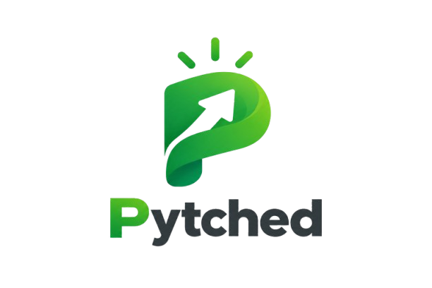

### Pitch Your Vision. Connect to Talent. Build the Future.

---

## 🚀 What is PytchEd?

**PytchEd** is a platform that bridges the gap between young innovators and the people who can help them grow. We give **Talent** a stage to pitch their ideas, and connect them directly with **Investors, Mentors, and Stakeholders** who can turn those ideas into reality.

No more untapped potential sitting in notebooks and group chats — PytchEd gets innovation *seen*, *tracked*, and *backed*.

## ✨ Core Features

- 🎥 **Pitch Profiles** — Share your vision through video pitches and a professional profile
- 📄 **CV Generation** — Auto-build a CV from your pitch and achievements
- 🔔 **Notifications** — Know when your pitch is watched and who's interested
- 💬 **Messaging** — Connect directly with investors, mentors, and talent
- 🏆 **Innovation Contests** — Compete in competitions hosted with universities and hubs like mHub
- 🤝 **Sponsorship Network** — Partners and sponsors fuel the next generation of innovators

## 🎯 Who It's For

| | |
|---|---|
| 🎓 **College Students** | Turn ideas into opportunity — pitch, get noticed, get backed |
| ✨ **Influencers** | Help spotlight rising talent and grow community impact |
| 💼 **Investors & Stakeholders** | Discover untapped talent before anyone else does |

## 🌍 Why PytchEd

Built with a focus on **Malawi's** untapped innovation market, PytchEd isn't just another exposure platform — it's a **connector**. We're closing the gap between innovators and the stakeholders who can help them, with real tracking, real investment, and real sponsorship.

## 📲 Access PytchEd

PytchEd is available on **Web**, **Android**, and **iOS** (coming soon).

## 🔗 Links

- 🌐 [Website](https://github.com/Pytched/website)
- 📧 [pytchedonline@gmail.com](mailto:pytchedonline@gmail.com)

---

 
© 2026 PytchEd. Built in Malawi 🇲🇼

